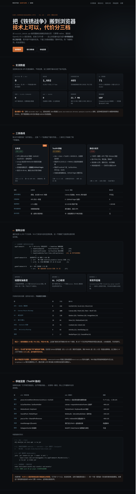

# 铁锈战争 · Web 部署包

> **AI 会话接手请先读 [AGENTS.md](AGENTS.md)** —— 完整交接记忆（实测数据、架构速查、文件地图、当前状态、未验证假设）。

把 `txzz115_136310.apk`（Rusted Warfare 1.15 / `com.corrodinggames.rts`）搬到浏览器上的
可行性实测 + 三条落地方案 + 一个可直接上 GitHub Pages 的站点。

**结论：能。** 但「能」有三种完全不同的含义，工作量和体验差两个数量级。

---

## 30 秒选择

| 你的目标 | 选它 | 工期 | 需要什么 |
|---|---|---|---|
| 现在就开个页面，别人点开能玩 | **[路线 A](#路线-a云串流1-2-天)** 云串流 | 1–2 天 | 一台 KVM VPS |
| 不养服务器，纯静态站里能玩 | **[路线 B](#路线-bteavm-移植2-4-人月)** TeaVM 移植 | 2–4 人月 | 一个愿意啃 GL 兼容层的人 |
| 只要一个介绍页 + 下载入口 | **[路线 C](#路线-c静态页已就绪)** 静态页 | 已完成 | 无 |

---

## 快速开始

```bash
./build.sh all       # 全链路：stubs → jar → dex → wasm → assets（16.7 秒，零错误）
./build.sh jar       # 只生成并编译桩
./build.sh wasm      # 只跑 TeaVM（产出 build/wasm/classes.js）
```

**五步目前全部可跑通**（工具链已备在 `tools/` 内，`build.sh` 自动发现）：

| 步骤 | 产物 | 实测 |
|---|---|---|
| stubs | `stubs/src/` 199 个 .java（245 类） | javac 零错误 |
| jar | `stubs/stubs.jar` | 112 KB |
| dex | `build/rw.jar` | 1,664 类 / 2.1 MB |
| wasm | `build/wasm/classes.js` | 84 类 / 1,240 方法 / 68 KB |
| assets | `build/assets/manifest.json` | 首屏 eager 0.8 MB |

缺依赖时先拉：

```bash
# dex2jar（19 MB）
curl -L -C - -o tools/dex-tools.zip \
  https://github.com/pxb1988/dex2jar/releases/download/v2.4/dex-tools-v2.4.zip
unzip -q tools/dex-tools.zip -d tools/dex-tools

# TeaVM（自动解析 56 个递归依赖）
python3 tools/fetch-maven.py org.teavm:teavm-cli:0.14.1 -o tools/teavm-lib
```

---

## 实测结果摘要

对 APK 直接解析（`python3 tools/dex-scan.py txzz.apk` 可复现全部数字）：

```
dex 文件: 3  |  native .so: 0  |  assets: 820 个
classes.dex      strings=12792 types=2152 methods=14121 classes=1630
classes2.dex     strings= 2843 types= 110 methods=  201 classes=  33
classes3.dex     strings=   55 types=  16 methods=   19 classes=   1

自有类: 1602   外部类: 465
```

决定性的三条：

1. **零 native 库** —— 不需要 ARM 翻译、不需要 Android 系统镜像
2. **GLES 1.1 固定管线（71 个入口）** —— 渲染层可在 Java 层整体换成 WebGL
3. **零 `Class.forName`、零 `loadLibrary`** —— AOT 编译器友好

---

## 路线 A：云串流（1–2 天）

游戏跑在服务器的 Android 容器里，浏览器负责显示与触控回传。前端是纯静态页，
**可以直接挂 GitHub Pages**，且体验与原版 100% 一致。

```
浏览器 → WSS → nginx → ws-scrcpy → adb → redroid(Android 11) → 游戏
```

```bash
sudo APK_PATH=/path/txzz115_136310.apk DOMAIN=rts.example.com ./deploy/stream-server.sh
```

细节、注意事项、成本估算见 `deploy/stream-server.sh` 头部注释与
[docs/PORTING.md#3-路线-a云串流最快可用](docs/PORTING.md)。

---

## 路线 B：TeaVM 移植（2–4 人月）

唯一不需要服务器的「浏览器内真跑」方案。构建链路：

```
txzz.apk ─ d2j-dex2jar → rw.jar ─(+stubs.jar)─ TeaVM AOT → out/*.wasm + *.js
                                                             └─ 静态托管
```

四层替换工作量：图形（71 个 GL 入口 → WebGL + 固定管线着色器模拟器，~1.5k LOC）、
窗口、输入、音频、存储。完整设计、统一着色器代码、风险表、里程碑见
[docs/PORTING.md](docs/PORTING.md)。

---

## 路线 C：静态页（已就绪）

`index.html` 单文件自包含，无外部依赖、无构建步骤。截图：



---

## 部署到 GitHub Pages

```bash
git init -b main
git add -A && git commit -m "Rusted Warfare web deployment hub"
git remote add origin git@github.com:<USER>/<REPO>.git
git push -u origin main
```

然后在仓库 **Settings → Pages → Source** 选 **GitHub Actions**。
`.github/workflows/pages.yml` 已就绪，push 后自动发布。

> APK 本体（25 MB）建议放 **Release 附件**而不是提交进仓库：避开大文件限制，也让 clone 保持轻量。
> 站点资源（21.7 MB）在 Pages 限额内，可以直接托管。

---

## 仓库结构

```
rw-web/
├── build.sh                        构建链（stubs / jar / dex / wasm / assets）
├── index.html                      落地页（自包含，可直接部署）
├── stubs/src/                      自动生成的 Java 桩源码（245 个类）
├── docs/
│   ├── ARCHITECTURE.md             架构还原（分层、主循环、线程模型）
│   ├── PORTING.md                  移植蓝图（GL 兼容层设计、构建链）
│   ├── stub-spec.md                781 个外部方法的完整接口规格
│   ├── dependency-surface.txt      465 个外部类型引用的清单
│   └── preview.png                 页面截图
├── deploy/
│   └── stream-server.sh            路线 A 一键部署（redroid + ws-scrcpy + nginx）
├── tools/
│   ├── dex-scan.py                 结构扫描（dex 头、类型引用、API 指纹）
│   ├── dex-calls.py                字节码级调用分析（方法级依赖、调用热度）
│   └── dex-flow.py                 调用图、可达性、入口点发现
└── .github/workflows/pages.yml     Pages 自动部署
```

## 复现分析

```bash
python3 tools/dex-scan.py  path/to/txzz.apk            # 结构扫描
python3 tools/dex-calls.py path/to/txzz.apk --json c.json  # 字节码级调用分析
python3 tools/dex-calls.py path/to/txzz.apk --show android/graphics --target android
python3 tools/dex-flow.py  path/to/txzz.apk --list-entries   # 入口点发现
```

仅依赖 Python 3 标准库。

---

静态分析对象 SHA-256：`f581e6852db3e22a2ce0521264b32386e2f7c1234342a382bb1da3c683cbe17a`
Rusted Warfare © Corroding Games。本仓库仅记录技术可行性，不含游戏本体。
